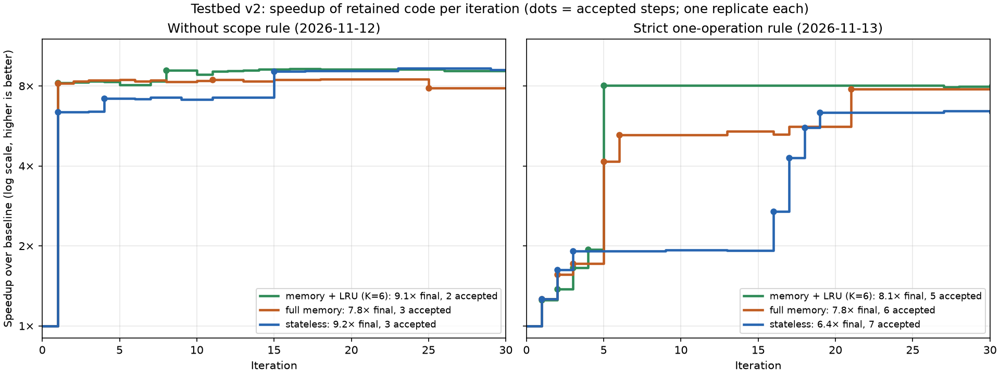
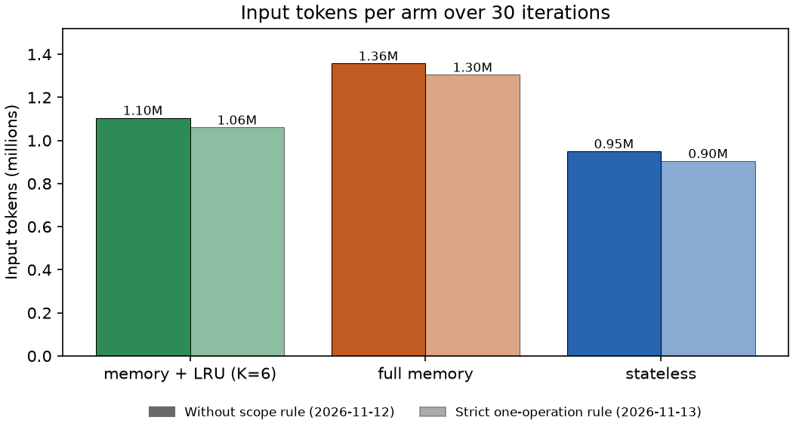
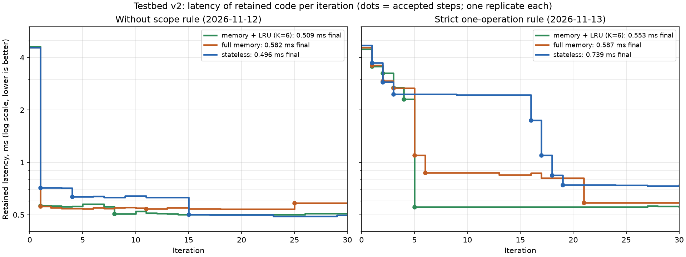
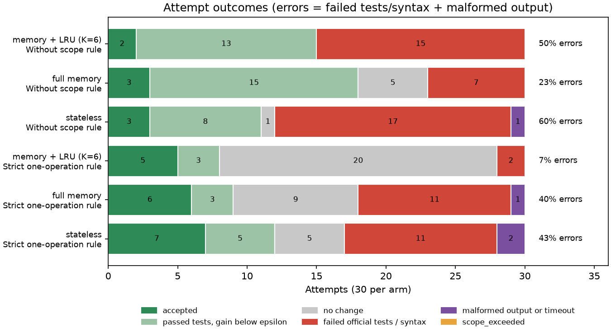
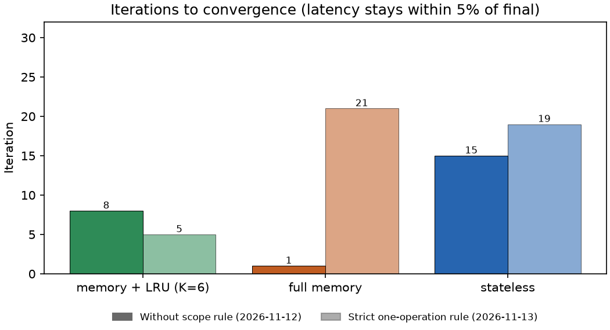
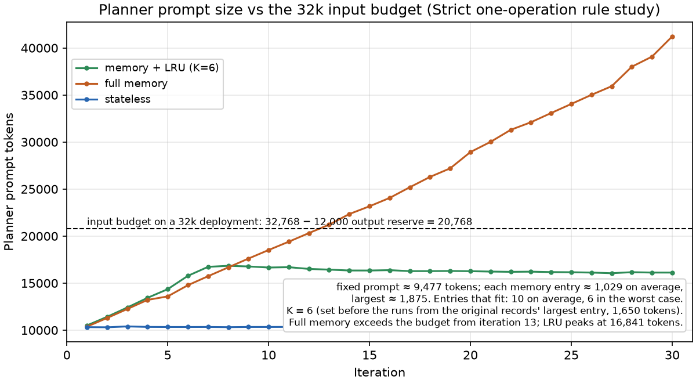

# Testbed v2 results: stateless vs full memory vs memory + LRU

Both studies are one replicate each, with SOCLAAS `qwen3.6:35b`, the `configs/lru-v2-study.yaml`
workload (2,000 notes, epsilon 0.08), 30 iterations per arm, and K = 6 for the LRU arm. They are
descriptive only.

| Study | Raw runs | Report |
|---|---|---|
| Without scope rule (2026-11-12) | `experiments/soclaas-lru-v2-unconstrained-2026-11-12/` | `…-report/` |
| Strict one-operation rule (2026-11-13) | `experiments/soclaas-lru-v2-strict-2026-11-13/` | `…-report/` |

The figures are in `experiments/lru-v2-figures/`, generated by `research/testbed-v2/figures.py`.

## Viewing the results without rerunning anything
All the recorded data is committed, including the raw artifacts and journals, so nothing needs to
be rerun and no model access is needed.

- **This page** shows the tables and figures. On GitHub, open `research/testbed-v2/RESULTS.md`.
- **Full reports:** open `experiments/soclaas-lru-v2-strict-2026-11-13-report/index.html` (and the
  `…-unconstrained-2026-11-12-report/` equivalent) in a browser. Each lists one cohort, with
  per-arm tables, figures and CSVs (`runs.csv`, `attempts.csv`, `comparisons.csv`, `lru.csv`).
- **Raw evidence per iteration** is in `experiments/soclaas-lru-v2-<study>/<arm>/`:
  - `attempts/NNN.json`: the plan, patch, test result, measurements, decision and tokens;
  - `patches/NNN.diff`: the code change;
  - `artifacts/NNN-*`: the exact prompts, raw model replies, test logs and benchmark output;
  - `lru/NNN.json`: what the LRU Planner was shown and what was evicted.
- **Regenerating the reports and figures from the recorded data** (offline, a few seconds):
  ```bash
  python -m pip install -r requirements.lock -r requirements-analysis.lock
  python -m lru_memory.report --runs-dir experiments/soclaas-lru-v2-strict-2026-11-13 --output /tmp/strict-report
  python research/testbed-v2/figures.py \
    --study "Without scope rule (2026-11-12)" experiments/soclaas-lru-v2-unconstrained-2026-11-12 \
    --study "Strict one-operation rule (2026-11-13)" experiments/soclaas-lru-v2-strict-2026-11-13 \
    --output /tmp/lru-v2-figures
  ```



## Without the scope rule: the arms can't be told apart
Every arm's first plan rewrote all the data operations at once. Iteration 1 took 83–98% of each
arm's total speedup (measured as a multiple), and the later accepted steps were near the noise.

| Arm | Final latency | Accepted steps | Input tokens |
|---|---|---|---|
| memory + LRU | 0.514 ms | 2 | 1.10M |
| full memory | 0.536 ms | 3 | 1.36M |
| stateless | 0.492 ms | 3 | 0.95M |

The final latencies are within about 9% of each other, which is within the noise for a single run.

## With the strict rule (one public data operation per patch, enforced before testing)

| Arm | Final latency | Speedup | Accepted steps (iterations) | Never fixed | Input tokens |
|---|---|---|---|---|---|
| memory + LRU | **0.560 ms** | **8.0×** | 5 (1–5) | — | 1.06M |
| full memory | 0.584 ms | 7.8× | 6 (1–3, 5, 6, 21) | — | 1.30M |
| stateless | 0.737 ms | 6.2× | 7 (1–3, 16–19) | `create_note` | 0.90M |

Final latency is the report's end-of-run re-measurement. The figure shows speedup from the last retained score
instead, so values differ by a few microseconds.

- **Memory helped.** Stateless finished 1.26× slower than full memory and 1.32× slower than LRU.
  Both memory arms fixed every operation within about 6 iterations. Stateless spent iterations
  4–15 retrying `list_notes` and never fixed `create_note`.
- **LRU matched full memory with 19% fewer input tokens.** The 4% latency gap between them is
  within the noise.
- **All arms stalled after the per-operation fixes.** None tried connection reuse (about 9%).
  - LRU produced 20 no-ops; it evicted 24 of 30 entries and cited memory in 29 of 30 plans.
  - Full memory kept trying `list_notes` variations: one more accepted step at iteration 21, then
    9 failures.



## Latency (log scale)


## Error rate
Errors are attempts that failed the official tests or had a syntax error, plus malformed output
and timeouts.

| Arm | Without the rule | With the strict rule |
|---|---|---|
| memory + LRU | 50% (15/30) | **7% (2/30)** |
| full memory | 23% (7/30) | 40% (12/30) |
| stateless | 60% (18/30) | 43% (13/30) |

LRU's low strict error rate comes with 20 no-op attempts: after iteration 5 it mostly proposed
changes that were already in place. No-ops aren't errors, but they are wasted iterations.



## Iterations to convergence
This is the first iteration after which retained latency stays within 5% of the arm's final value.

| Arm | Without the rule | With the strict rule |
|---|---|---|
| memory + LRU | 8 | **5** |
| full memory | 1 | 21 |
| stateless | 15 | 19 |

Under the strict rule, full memory was within 1.5× of its final latency by iteration 6, but its
last accepted step came at iteration 21. Without the rule, iteration 1 had already done most of the
work in every arm.



## Why K = 6
- **K was fixed before the runs.** It was derived from the original study's records:
  (32,768 context − 10,000 fixed prompt − 12,000 output reserve) / 1,650 tokens for the largest
  recorded entry ≈ 6.5, so K = 6. That's the most entries guaranteed to fit a 32k deployment
  together with the output reserve.
- **The v2 runs confirm it.** A linear fit of full-memory Planner prompt size against the number of
  entries shown (strict study) gives a fixed prompt of about 9,477 tokens, about 1,029 tokens per
  average entry, and about 1,875 for the largest entry:
  - on average, 10 entries fit;
  - in the worst case, **6** fit.

  K = 6 is the largest capacity that can't overflow, even when every shown entry is as large as
  the largest observed.
- **It binds, and it never overflowed:**
  - Full memory crossed the 20,768-token input budget at iteration 13 and reached about 41k by
    iteration 30.
  - With K = 6, the LRU prompt peaked at 16,841 tokens.
  - The cache evicted 24 of 30 entries, so the cap was active from iteration 7.
- **K = 6 sits within the native window.** The model's native 262k window would never evict, so it
  wouldn't test LRU at all; K = 6 is what a realistic 32k deployment forces. The unconstrained study
  gives the same picture: 7 fit in the worst case, and full memory crossed the budget at iteration 12.



## Caveats
- **One replicate.** The memory-vs-stateless gap partly comes from a single 12-iteration stateless
  stall. More replicates are needed before drawing conclusions.
- **Phase label.** The configs use `phase: smoke` because the controller caps `pilot` at 10
  iterations, so the standard report titles say "SMOKE".
- **Order.** The arms ran in sequence on one host (LRU, then memory, then stateless), so host drift
  is not balanced across arms.
